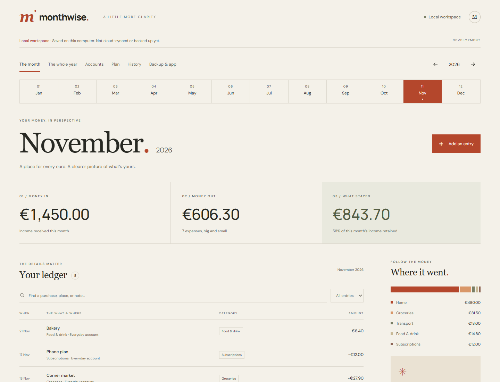

# Monthwise

Monthwise is a personal budgeting app for tracking where your money went and what you have left to plan with. It runs as an installable web app and can queue new income and expenses when you lose your connection.

**[Open Monthwise](https://monthwise.online/)** · [Mobile preview](docs/preview-mobile.png) · [Architecture](docs/ARCHITECTURE.md)



The previews use fictional transactions in a local workspace. The hosted app requires Google sign-in.

## What you can do

- Track income, expenses and transfers across cash, bank and savings accounts. Review monthly and yearly totals, or search the full transaction history.
- Set category budgets, plan upcoming bills and expected income, and allocate money to savings goals. Paying a planned bill records its expense once.
- Install from Safari using **Share → Add to Home Screen** and open the installed app online once. You can then review cached records and add income or expenses offline. Edits, transfers, planning changes and restores require a connection.
- Export CSV or Excel reports and download a JSON backup. Restore adds missing records to the same owner's ledger and stops if existing records conflict.

## How it works

The React and TypeScript frontend is built with Vite. A Cloudflare Worker serves the app, handles Google sign-in and stores separate user ledgers in D1. Amounts use integer cents, and transfers affect account balances without affecting income or expenses. IndexedDB stores an owner-scoped snapshot and a queue. Entries keep a stable ID when retried so the same save cannot create two transactions.

## Run locally

Use Node.js 22.21 or newer.

```sh
npm ci
npm run dev
```

Open http://127.0.0.1:5173. The dev command applies migrations to a local D1 database and starts the API and frontend. It uses a development identity without Google sign-in. Use fictional data.

Run `npm test` for unit and integration tests. Run `npm run check` for the full suite, including a synthetic SQL recovery drill and browser tests. The full suite requires Microsoft Edge plus Playwright's Chromium and WebKit (`npx playwright install chromium webkit`). GitHub Actions runs the checks without deploying. [Project checks](https://github.com/fnebihi10/Monthwise/actions/workflows/checks.yml)

## Release status

The public app uses a separate database from the owner-only deployment. Run `npm run check:hosted` to verify the homepage, public health, anonymous ledger protection, the Google redirect and the running Worker version. The [deployment log](docs/PUBLIC-DEPLOYMENT.md) records the active release. The [acceptance checklist](docs/ACCEPTANCE.md) covers real Google accounts, physical iPhone offline behavior and recovery.

See [operating instructions](docs/OPERATIONS.md) for routine maintenance, [release checklist](docs/RELEASE-CHECKLIST.md) for deployment, and [quality evidence](docs/QUALITY-STATUS.md) for what has been exercised.
